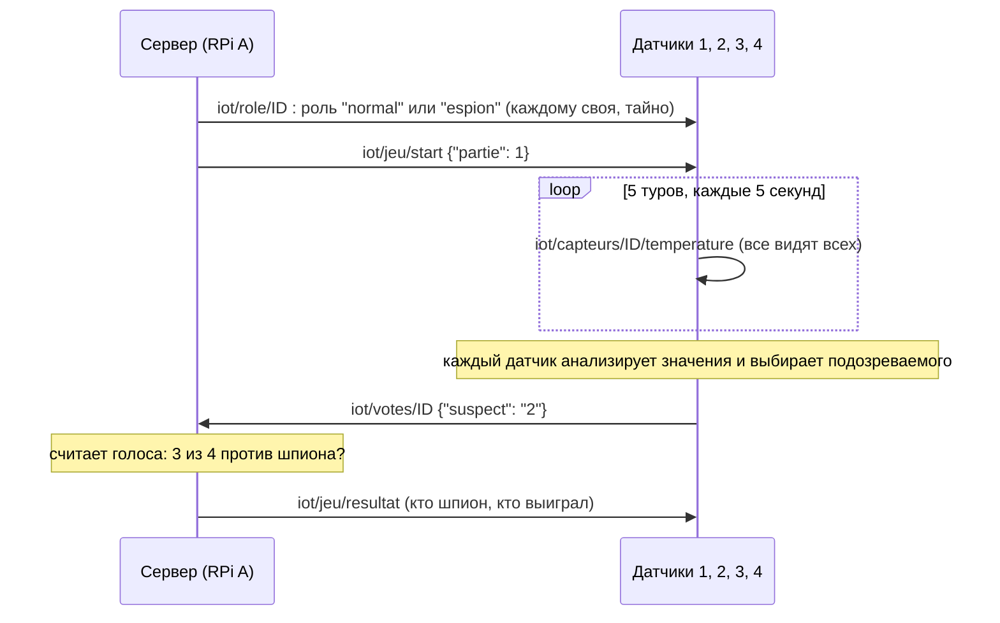

# Гайд для команды: как работает игра и как её запустить

Здесь всё, что нужно, чтобы понять принцип и сыграть партию. Команды в серых
блоках можно копировать целиком и вставлять в терминал как есть.

---

## 1. Суть за 30 секунд

- 4 датчика публикуют температуру своего города каждые 5 секунд.
- Сервер тайно выбирает одного **шпиона**. Шпион публикует фальшивые значения:
  среднее остальных ± 5–10 %.
- После 5 туров каждый датчик **сам** решает, кто шпион, и голосует.
- Если **3 голоса из 4** указали на шпиона, выигрывают датчики, иначе шпион.

Голосовать руками не нужно: каждый датчик голосует автоматически по своей
**стратегии** (алгоритму поиска шпиона).

---

## 2. Кто где работает

| Машина | Что на ней запускается | Город |
|---|---|---|
| **RPi A** (Nazar, `rpi-a.local`) | брокер MQTT + **сервер** + датчик 1 + датчик 4 | Annecy, Rumilly |
| **RPi B** | датчик 2 | Chambéry |
| **RPi C** | датчик 3 | Aix-les-Bains |

**Датчик 4 виртуальный.** По заданию нужно 4 RPi, а у нас 3, поэтому четвёртый
датчик — это та же программа, просто запущенная второй раз на RPi A. Он работает
как настоящий: получает роль, может быть шпионом, голосует.

Брокер MQTT стоит только на RPi A. Все остальные подключаются к нему по сети.

---

## 3. Как идёт одна партия



1. **Роли.** Сервер отправляет каждому датчику его роль. Свою роль датчик знает,
   чужие — нет.
2. **Старт.** Сервер публикует `start` с номером партии.
3. **5 туров.** Каждые 5 секунд датчик публикует температуру:
   - честный — настоящую, из Open-Meteo;
   - шпион — выдуманную, около среднего остальных ± 5–10 %, каждый тур
     по-разному.
4. **Голос.** После 5 туров датчик запускает свою стратегию на всех полученных
   значениях и отправляет голос.
5. **Результат.** Сервер считает голоса и публикует, кто был шпионом и кто
   выиграл. Датчики сами переходят к ожиданию следующей партии, перезапускать
   их не нужно.

Почему шпиона можно поймать: настоящая температура за 25 секунд не меняется,
поэтому у честного датчика 5 одинаковых чисел, а у шпиона они прыгают.

---

## 4. Сообщения MQTT

| Топик | Кто → кому | Пример |
|---|---|---|
| `iot/role/<id>` | сервер → датчик | `{"role": "espion"}` |
| `iot/jeu/start` | сервер → все | `{"partie": 3}` |
| `iot/capteurs/<id>/temperature` | датчик → все | `{"id": "2", "ville": "Chambery", "partie": 3, "tour": 1, "temperature": 13.4}` |
| `iot/votes/<id>` | датчик → сервер | `{"id": "2", "partie": 3, "suspect": "4", "strategie": "mediane"}` |
| `iot/jeu/resultat` | сервер → все | `{"partie": 3, "espion": "4", "designe": "4", "gagnant": "capteurs", ...}` |

**Поле `"partie"` (номер партии) обязательно.** Сервер выбрасывает температуры
и голоса с чужим номером, чтобы опоздавшее сообщение прошлой партии не попало
в новую.

---

## 5. Первая настройка своей RPi (один раз)

Выполнить на **RPi B** и на **RPi C**.

**5.1. Скачать последнюю версию кода**

```bash
cd ~/jeu-distribue
git checkout main
git pull
```

> Если Nazar ещё не смержил изменения в `main`, вместо `git checkout main`
> выполните `git fetch && git checkout feature/integration`.
>
> Если `git pull` ругается на локальные изменения: `git stash`, затем снова `git pull`.

**5.2. Установить зависимости**

```bash
cd ~/jeu-distribue
[ -d venv ] || python3 -m venv venv
venv/bin/pip install -r requirements.txt
chmod +x jeu.sh
sudo apt install -y mosquitto-clients
```

**5.3. Проверить, что всё на месте**

```bash
cd ~/jeu-distribue
ping -c 2 rpi-a.local
venv/bin/python -m capteur.meteo
```

Ожидаемо: `ping` получает ответы, а вторая команда печатает число (температура
в Annecy). Если `ping` не проходит, вы не в той сети, что RPi A.

---

## 6. Сыграть партию

**Порядок важен: сначала все датчики, сервер последним.** Сообщение `start` не
сохраняется на брокере: датчик, запущенный после старта, его пропустит.

**RPi B:**

```bash
cd ~/jeu-distribue && ./jeu.sh capteur 2
```

**RPi C:**

```bash
cd ~/jeu-distribue && ./jeu.sh capteur 3
```

**RPi A** (делает Nazar, в 3 разных терминалах):

```bash
cd ~/jeu-distribue && ./jeu.sh capteur 1
```

```bash
cd ~/jeu-distribue && ./jeu.sh capteur 4
```

```bash
cd ~/jeu-distribue && ./jeu.sh serveur
```

Каждое нажатие **Entrée** в терминале сервера запускает новую партию.
Остановить что угодно: **Ctrl+C**.

**Посмотреть весь трафик** (необязательно, с любой RPi):

```bash
cd ~/jeu-distribue && ./jeu.sh trafic
```

---

## 7. Что вы увидите в терминале датчика

```
[capteur-2] Chambery, stratégie mediane - attente du start...   ← ждёт партию
[capteur-2] connecté au broker                                  ← брокер найден
[capteur-2] rôle reçu : normal                                  ← моя роль
[capteur-2] start de la partie 1                                ← старт
[capteur-2] tour 1 : 13.4 °C (normal)                           ← 5 туров по 5 с
...
[capteur-2] tour 5 : 13.4 °C (normal)
[capteur-2] vote : 4 (mediane)                                  ← мой голос
[capteur-2] attente de la partie suivante...
[capteur-2] résultat : espion 4, désigné 4 -> victoire des CAPTEURS (votes {...})
```

Если датчику выпала роль шпиона, будет `rôle reçu : espion`, а в турах —
`(espion)` и выдуманные значения.

Строка `rôle reçu` сразу после запуска нормальна: брокер хранит роль с прошлой
партии. Новая роль придёт при следующем старте.

---

## 8. Стратегии: как датчик выбирает подозреваемого

Стратегия задаётся **вторым словом** при запуске датчика:

| Команда | Стратегия | Как работает |
|---|---|---|
| `./jeu.sh capteur 2` | `mediane` (по умолчанию) | В каждом туре считает медиану всех значений. Подозрительность датчика = насколько он в среднем далёк от медианы + насколько скачут его значения. Голос — за самого подозрительного |
| `./jeu.sh capteur 2 aleatoire` | `aleatoire` | Голосует наугад. Нужна только для сравнения |
| `./jeu.sh capteur 2 llm` | `llm` | Отправляет все значения локальной модели Ollama и голосует так, как она ответит (см. раздел 9) |

Шпион тоже голосует по своей стратегии, но за себя никогда — всегда против
невиновного.

### Написать свою стратегию

В задании сказано, что у каждого студента может быть своя стратегия. Это один
файл с одной функцией.

**1. Создать ветку и файл** (вместо `ma_strategie` своё имя, латиницей, без пробелов):

```bash
cd ~/jeu-distribue
git checkout main && git pull
git checkout -b feature/strategie-ma_strategie
cat > strategies/ma_strategie.py <<'EOF'
from strategies.base import autres


def choisir_suspect(mon_id, historique):
    # historique = {"1": [12.9, 12.9, ...], "2": [...], ...}  (я тоже внутри)
    candidats = autres(mon_id, historique)      # {id: [значения]} без меня
    ma_valeur = historique[mon_id][-1]           # моя последняя температура
    # пример: тот, чьё последнее значение дальше всего от моего
    return max(candidats, key=lambda i: abs(candidats[i][-1] - ma_valeur))
EOF
```

Правила для функции:
- возвращает id **строкой** (`"2"`, не `2`);
- не возвращает свой собственный id;
- если функция упадёт, датчик проголосует наугад и пометит голос
  `aleatoire (échec ...)`.

**2. Зарегистрировать имя** в списке `NOMS` в `strategies/__init__.py`:

```python
NOMS = ("mediane", "aleatoire", "llm", "ma_strategie")
```

**3. Проверить без сети на 2000 симулированных партиях и сравнить с `mediane`:**

```bash
cd ~/jeu-distribue && venv/bin/python -m strategies.simulation --strategies mediane,aleatoire,ma_strategie
```

Пример выше даёт около 76 % верных голосов против 100 % у `mediane`.
Улучшайте, пока не станет лучше.

**4. Сыграть с ней по-настоящему:**

```bash
cd ~/jeu-distribue && ./jeu.sh capteur 2 ma_strategie
```

**5. Отправить на GitHub и открыть Pull Request:**

```bash
cd ~/jeu-distribue
git add strategies/ma_strategie.py strategies/__init__.py
git commit -m "Strategie ma_strategie"
git push -u origin feature/strategie-ma_strategie
```

---

## 9. Расширение: голосование через LLM (Ollama)

По заданию **каждая RPi запускает свой Ollama**. Датчик обращается к Ollama на
своей же машине.

**Установка, один раз на каждой RPi** (скачивается около 1,5 ГБ):

```bash
curl -fsSL https://ollama.com/install.sh | sh
ollama pull qwen3:1.7b
```

**Проверить, что модель есть:**

```bash
ollama list
```

**Запустить датчик с LLM:**

```bash
cd ~/jeu-distribue && ./jeu.sh capteur 2 llm
```

Голос приходит через 10–20 секунд после 5-го тура, вместе с объяснением модели.
Если у RPi мало памяти (меньше 4 ГБ), возьмите модель поменьше:

```bash
ollama pull qwen3:0.6b
```

```bash
cd ~/jeu-distribue && ./jeu.sh capteur 2 llm --modele qwen3:0.6b
```

Первые измерения (всего 20 голосов, так что пока ориентировочно): `mediane`
угадывает почти всегда, LLM — примерно в 55–60 % случаев. Сравнить на реальных партиях — главный вопрос расширения (раздел 10).

---

## 10. Статистика (на RPi A)

Сервер записывает каждую партию в `docs/parties.jsonl`. Сводка по стратегиям:

```bash
cd ~/jeu-distribue && ./jeu.sh bilan
```

Она показывает, какой процент голосов честных датчиков оказался верным для
каждой стратегии. Ещё она **переигрывает** те же партии через `mediane` на тех
же самых значениях: так видно, лучше или хуже LLM, чем алгоритм.

10 партий подряд без нажатия Entrée:

```bash
cd ~/jeu-distribue && ./jeu.sh serveur 10
```

---

## 11. Если что-то не работает

| Что видно | Причина | Что делать |
|---|---|---|
| `déconnecté du broker ... Si ce message se répète` каждую секунду | Два датчика запущены с одним id | Ctrl+C в лишнем терминале, проверить номер в команде |
| Датчик висит на `attente du start...`, хотя партия идёт | Датчик запустили **после** Entrée на сервере | Дождаться следующей партии, она подхватится |
| Ошибка подключения сразу при запуске (`ConnectionRefusedError`, `gaierror`) | Брокер недоступен | `ping -c 2 rpi-a.local`; проверить, что RPi A включена и в той же сети |
| Сервер пишет `pas de vote de : ['2']` | Датчик 2 не запущен или упал | Посмотреть его терминал, перезапустить |
| Сервер пишет `vote de 2 ignoré : il concerne la partie None` | На RPi старая версия кода | Раздел 5.1: `git pull` |
| `erreur Open-Meteo` | Нет интернета | Датчик продолжает со своим последним значением, партия не ломается |
| `stratégie llm en échec` | Ollama не установлен или модель не скачана | `ollama list`, раздел 9 |
| `invalid choice` при запуске | Опечатка в id или стратегии | id: 1–4; стратегии: `mediane`, `aleatoire`, `llm` |

---

## 12. Правила команды

- Не работаем прямо в `main`: своя ветка → Pull Request → merge.
- Всё, что отличается между машинами (номер датчика, стратегия), задаётся при
  запуске командой, а не правкой `config.py`.
- Топики и формат сообщений (раздел 4) меняем только договорившись: от них
  зависят все.
- Команды запускаем из папки `~/jeu-distribue` (`./jeu.sh` сам включает venv).
